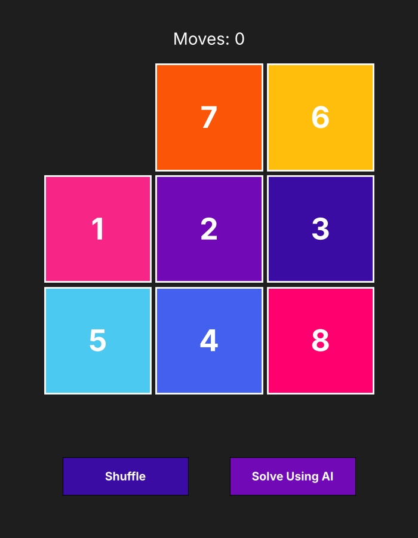

# AI-Powered Klotski (8-Puzzle) Solver


> A sliding-tile puzzle you can play yourself, or hand to the AI. Press **Solve Using AI** and **A\* search with a Manhattan-distance heuristic** finds the shortest solution and animates it tile by tile.

<p align="center"></p>

## ✨ Features

- **Playable 3×3 sliding puzzle:** click a tile next to the gap to slide it.
- **Shuffle** creates a random board and checks with an inversion count that it is **solvable** before showing it.
- **Solve Using AI** runs A\* search, then animates the optimal sequence of moves and reports the solve time in the console.
- **Move counter** and a modern dark theme with a distinct colour for each tile.
- **Unit test** in `scratch/test_solver.py` that checks the solver on a known position.

## 🧠 How the AI solves it

| Component | Implementation |
|---|---|
| **State** | A 9-tuple such as `(1, 2, 3, 4, 5, 6, 7, 8, 0)`, where `0` is the blank |
| **Actions** | Move the blank `UP`, `DOWN`, `LEFT` or `RIGHT` |
| **Goal** | `(1, 2, 3, 4, 5, 6, 7, 8, 0)` |
| **Search** | `astar_search(problem, h=manhattan_distance)` |
| **Heuristic** | Sum of each tile's row and column distance from its goal square |

A\* ranks nodes by **f(n) = g(n) + h(n)**: the moves made so far plus the estimated moves still needed. Manhattan distance never overestimates the true cost (it is **admissible**), so A\* is guaranteed to return the **shortest** solution. It also expands far fewer states than uninformed search such as BFS.

```python
def manhattan_distance(node):
    dist = 0
    for i, val in enumerate(node.state):
        if val != 0:
            r, c = divmod(i, 3)              # where the tile is now
            gr, gc = divmod(val - 1, 3)      # where it should be
            dist += abs(r - gr) + abs(c - gc)
    return dist
```

## 🚀 Getting started

```bash
git clone https://github.com/kfahchai/COS30019-INTRO-TO-AI-KLOTSKI-PUZZLE.git
cd "COS30019-INTRO-TO-AI-KLOTSKI-PUZZLE/Kloiski Puzzle"
pip install matplotlib
python klotski_gui.py
```

**Controls:** click **Shuffle**, try to solve it yourself by clicking tiles, or click **Solve Using AI** and watch.

## 📁 Project structure

```
Kloiski Puzzle/
├── klotski_gui.py        # ▶ Entry point: Matplotlib GUI + Manhattan heuristic
├── search.py             # AIMA search algorithms (EightPuzzle, astar_search, ...)
├── utils.py              # AIMA helpers (priority queue, etc.)
└── scratch/
    └── test_solver.py    # Checks the solver on a known 1-move position
```

## 📚 Key concepts

Informed (heuristic) search · A\* · Admissible heuristics · Manhattan distance · Puzzle solvability (inversion parity) · Event-driven GUIs

## 🙏 Acknowledgements

`search.py` and `utils.py` come from **[aima-python](https://github.com/aimacode/aima-python)** (MIT License), the code companion to Russell & Norvig's *Artificial Intelligence: A Modern Approach*.

---

<sub>Made by **Kean Fah Chai** · Swinburne University of Technology Sarawak</sub>
